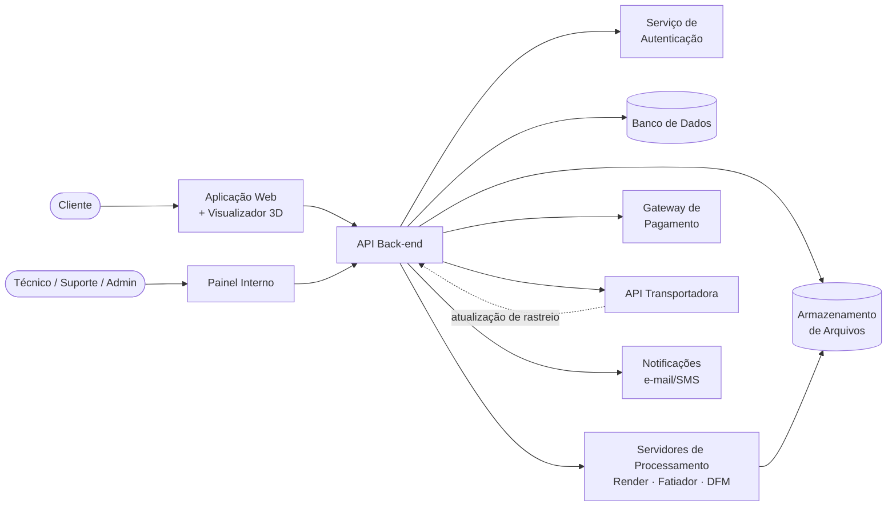

# Etapa 1 — Casos de Abuso e Modelagem de Ameaças com STRIDE

## 1. Identificação do sistema

**Nome do sistema:** nugget-machine-3thousand-kill-master-0800

**Integrantes do grupo:**

* Arthur Faria Silva
* Gustavo Duarte Ventino

**Endereço do repositório:** <https://github.com/Tutu4000/modelagem-software-seguro>

**Justificativa da escolha:** uma plataforma de impressão 3D sob demanda possui diferentes tipos de usuários (clientes, técnicos de produção, suporte e administradores), armazena informações de alto valor (arquivos STL e desenhos técnicos que podem ser projetos ainda não patenteados), processa arquivos enviados pelos próprios usuários, realiza pagamentos e depende de serviços externos (gateway de pagamento e transportadoras). Essas características permitem identificar ameaças em todas as categorias do STRIDE.

## 2. Descrição do sistema

**Qual problema o sistema resolve:** pessoas e empresas que precisam de peças impressas em 3D normalmente não possuem impressoras industriais nem sabem se o modelo é fabricável. O sistema permite que o cliente envie um arquivo 3D, configure a peça, receba um orçamento, pague e acompanhe a produção e a entrega.

**Quem utiliza o sistema:**

* **Clientes:** pessoas físicas, makers, engenheiros e pequenas empresas que encomendam peças.
* **Técnicos de produção:** revisam a manufaturabilidade dos projetos, operam as impressoras e atualizam o status dos pedidos.
* **Atendentes de suporte:** respondem dúvidas, solicitações de cancelamento e problemas de entrega.
* **Administradores:** gerenciam materiais, preços, descontos, estoque e usuários internos.

**Principais funcionalidades:**

* **Autenticação:** RF01 – Login de usuário.
* **Preparação do pedido:** RF02 – Upload de STL; RF03 – Visualização prévia 3D; RF04 – Seleção de material e cor; RF05 – Configuração de fatiamento e qualidade; RF06 – Cálculo de orçamento; RF18 – Acesso a fichas técnicas; RF19 – Pré-análise de manufaturabilidade (DFM); RF21 – Acabamento e pós-processamento; RF22 – Serviços de montagem e inserções metálicas (com upload de PDF); RF23 – Compra de componentes avulsos; RF24 – Desconto progressivo por volume.
* **Pagamento e logística:** RF07 – Cálculo de frete; RF08 – Processamento de pagamento.
* **Pós-compra:** RF09 – Histórico de pedidos; RF10 – Solicitação de cancelamento; RF11 – Canal de suporte; RF12 – Acompanhamento de status; RF13 – Avaliação do serviço; RF20 – Status de auditoria/revisão do projeto.
* **Fluxos alternativos:** RF14 – Notificação de problemas de impressão; RF15 – Notificação de problemas de envio; RF16 – Notificação de ruptura de estoque; RF17 – Tratamento de erros de contato.

**Informações armazenadas ou transmitidas:**

* dados cadastrais (nome, e-mail, telefone, CPF/CNPJ e endereço de entrega);
* credenciais e sessões;
* arquivos STL e desenhos técnicos em PDF;
* configurações do pedido, orçamentos e descontos;
* dados das transações de pagamento;
* laudos de análise DFM e pareceres técnicos;
* histórico, status de produção e rastreio dos pedidos;
* mensagens de suporte e avaliações.

**Recursos que precisam ser protegidos:** os projetos dos clientes (STL e PDF), as contas de usuário, os valores de orçamento e pagamento, o status dos pedidos, o painel interno de aprovação técnica e a disponibilidade dos serviços de renderização, fatiamento e análise DFM.

## 3. Usuários, ativos e pontos de interação

### 3.1 Usuários e perfis de acesso

|Perfil|Acesso|
|-|-|
|Cliente|Envia arquivos, configura, paga, acompanha, cancela e avalia os próprios pedidos|
|Atendente de suporte|Consulta pedidos de clientes, responde chamados e altera dados de entrega|
|Técnico de produção|Acessa os arquivos dos clientes, emite laudo DFM, aprova ou reprova projetos e altera o status de produção|
|Administrador|Gerencia preços, descontos, materiais, estoque e contas internas|

### 3.2 Elementos do sistema

|Elemento|Descrição|Ativo importante?|
|-|-|-|
|Arquivos STL e desenhos técnicos (PDF)|Projetos dos clientes, podendo conter segredos industriais|Sim|
|Credenciais e sessões|Acesso de clientes e da equipe interna|Sim|
|Pagamentos|Transações processadas pelo gateway|Sim|
|Dados pessoais|Nome, CPF/CNPJ, telefone e endereço de entrega|Sim|
|Orçamentos e descontos|Valores calculados para cada pedido|Sim|
|Status e histórico dos pedidos|Situação de produção, entrega e cancelamentos|Sim|
|Laudos DFM e aprovações técnicas|Pareceres emitidos pelos técnicos|Sim|
|Avaliações e mensagens de suporte|Opiniões dos clientes e atendimentos|Não|
|Banco de dados|Usuários, pedidos, preços, status e avaliações|Sim|
|Armazenamento de arquivos (bucket)|Guarda STL, PDFs e laudos|Sim|
|Servidores de processamento|Renderização, fatiamento e análise DFM dos arquivos enviados|Sim|
|Painel interno|Usado por técnicos, suporte e administradores|Sim|
|API de back-end|Regras de negócio do sistema|Sim|
|Aplicação web|Interface do cliente e visualizador 3D|Não|
|Logs de auditoria|Registro das ações realizadas no sistema|Sim|
|Serviços externos|Gateway de pagamento, API das transportadoras e serviço de notificações|Não|

Os elementos marcados como ativos importantes são aqueles que podem causar prejuízos caso sejam acessados, alterados, destruídos ou indisponibilizados indevidamente.

## 4. Visão geral da arquitetura e fluxo

**Fluxo principal:**

1. O cliente faz login (RF01) e envia o arquivo STL (RF02), que é salvo no armazenamento de arquivos.
2. Os servidores de processamento geram a visualização prévia (RF03). O cliente escolhe material, cor, qualidade, acabamento e montagem (RF04, RF05, RF21, RF22).
3. O sistema faz o fatiamento e a análise DFM (RF19), calcula o orçamento (RF06, RF23, RF24) e cota o frete com a transportadora (RF07).
4. Quando a análise exige revisão humana, o pedido fica como "Aguardando Revisão Técnica" até o técnico aprová-lo pelo painel interno (RF20).
5. O cliente paga pelo gateway (RF08) e o pedido entra em produção, com o status atualizado (RF12).
6. A transportadora envia as atualizações de rastreio. Falhas geram notificações ao cliente (RF14 a RF17).
7. O cliente consulta o histórico (RF09), pode cancelar (RF10), falar com o suporte (RF11) e avaliar o serviço (RF13).

## 5. Modelagem de ameaças com STRIDE

|ID|Categoria STRIDE|Componente ou ativo|Ameaça identificada|Possível impacto|
|-|-|-|-|-|
|T01|Spoofing|Conta do usuário (RF01)|Um atacante obtém credenciais de acesso ou sequestra a sessão de um usuário legítimo|Acesso aos projetos e dados da vítima e realização de pedidos fraudulentos|
|T02|Spoofing|Suporte e dados de entrega (RF08, RF11)|Um atacante se passa por um usuário legítimo junto ao suporte para alterar o endereço de entrega ou realizar transações indevidas|Desvio de entrega e prejuízo financeiro|
|T03|Spoofing|Painel interno de aprovação (RF20)|Um atacante se passa por técnico da equipe de produção para acessar a plataforma interna de aprovação de projetos|Acesso aos projetos de todos os clientes e aprovações indevidas|
|T04|Spoofing|Integração com a transportadora (RF07)|Um atacante falsifica a origem de requisições à API de logística para se passar por transportadora homologada|Valores de frete e status de entrega falsos|
|T05|Tampering|Arquivo STL (RF02)|Um atacante intercepta ou altera o arquivo STL enviado para injetar defeitos estruturais ocultos ou conteúdo malicioso no pré-processamento|Fabricação de peça defeituosa e comprometimento do processamento|
|T06|Tampering|Status do pedido (RF10, RF12, RF14, RF15, RF20)|Manipulação de parâmetros da requisição para alterar o status de pedidos de terceiros (cancelar, aprovar ou forçar status de produção ou entrega)|Cancelamentos e aprovações indevidas e atraso na produção|
|T07|Tampering|Orçamento (RF04, RF05, RF06, RF23)|Um usuário altera requisições HTTP para adulterar o cálculo do orçamento, obtendo preços zerados ou descontos indevidos|Prejuízo financeiro|
|T08|Tampering|Desconto por volume (RF24)|Adulteração dos parâmetros de desconto progressivo para obter abatimento sem atingir a quantidade mínima|Prejuízo financeiro|
|T09|Tampering|Laudo técnico DFM (RF20)|Injeção de alterações maliciosas nas instruções e relatórios de avaliação técnica enviados ao usuário|Cliente altera o projeto com base em orientação falsa, resultando em peça defeituosa|
|T10|Repudiation|Pagamento (RF08)|O cliente alega ter realizado o pagamento sem que existam registros auditáveis ou comprovantes no gateway|Disputa financeira sem evidências|
|T11|Repudiation|Cancelamento (RF10)|O cliente contesta ter solicitado o cancelamento de um pedido por falta de logs de confirmação|Disputa de reembolso sem evidências|
|T12|Repudiation|Aprovação técnica (RF20)|O técnico nega ter aprovado um modelo com falhas graves de manufaturabilidade que resultaram em prejuízo|Impossibilidade de apurar a responsabilidade pela falha|
|T13|Repudiation|Avaliações (RF13)|O usuário nega ter submetido uma avaliação ofensiva ou improcedente sobre o serviço|Danos à reputação sem responsabilização|
|T14|Information Disclosure|Armazenamento de arquivos STL (RF02, RF03)|Arquivos STL proprietários ou projetos confidenciais são expostos a terceiros por falhas de controle de acesso no armazenamento|Vazamento de propriedade intelectual|
|T15|Information Disclosure|Dados de pagamento (RF08)|Dados de pagamento são expostos em logs indevidos ou por permissões mal configuradas na API de checkout|Fraude financeira e violação de privacidade|
|T16|Information Disclosure|Histórico, cadastro e laudos (RF09, RF10, RF20)|O histórico de compras, os dados de entrega ou os laudos técnicos de outros clientes são expostos|Violação de privacidade|
|T17|Information Disclosure|Desenhos técnicos em PDF (RF22)|Acesso não autorizado a desenhos técnicos com segredos industriais e instruções de montagem enviados pelo cliente|Vazamento de propriedade intelectual|
|T18|Denial of Service|Autenticação (RF01)|Ataques de força bruta no login indisponibilizam o acesso de usuários legítimos|Clientes impedidos de acessar o sistema|
|T19|Denial of Service|Upload e armazenamento (RF02)|Upload massivo de arquivos maliciosos, zip bombs ou modelos com milhões de polígonos para esgotar armazenamento e processamento|Indisponibilidade do serviço|
|T20|Denial of Service|Servidores de processamento (RF03, RF05, RF06, RF19)|Requisições concorrentes de modelos de alta densidade sobrecarregam a renderização, o fatiamento e a análise DFM|Indisponibilidade de orçamentos e pedidos|
|T21|Elevation of Privilege|Servidores de processamento (RF02, RF03)|Execução remota de código por meio de vulnerabilidades no fatiador ou no visualizador 3D ao processar o STL enviado|Controle dos servidores e acesso aos arquivos de todos os clientes|
|T22|Elevation of Privilege|Controle de acesso do painel (RF19, RF20)|Um usuário comum contorna os controles de acesso para aprovar a análise técnica das próprias peças ou acessar o painel administrativo|Aprovações indevidas e acesso a funções administrativas|

Todas as categorias do STRIDE foram consideradas aplicáveis ao sistema.

## 6. Casos de abuso

#### CA01 — Roubo de projeto confidencial

**Ator:** concorrente ou atacante interessado em espionagem industrial.

**Objetivo:** obter arquivos STL e desenhos técnicos de projetos de outros clientes.

**Condições:** o armazenamento de arquivos permite acessar arquivos de outros clientes alterando o identificador na URL.

**Fluxo de abuso:**

1. O atacante cria uma conta e envia um arquivo qualquer.
2. O atacante observa o endereço do próprio arquivo no visualizador 3D.
3. O atacante altera o identificador no endereço e acessa arquivos de outros clientes.
4. O atacante baixa os projetos e desenhos técnicos.

**Impacto:** vazamento de propriedade intelectual e perda de confiança no sistema.

**Categorias STRIDE relacionadas:** Information Disclosure.

#### CA02 — Arquivo STL malicioso

**Ator:** atacante externo com conta de cliente.

**Objetivo:** executar código nos servidores de processamento.

**Condições:** o fatiador ou o visualizador 3D possui uma vulnerabilidade conhecida e os servidores de processamento têm acesso amplo ao armazenamento.

**Fluxo de abuso:**

1. O atacante identifica a versão do fatiador utilizada.
2. O atacante cria um arquivo STL que explora a vulnerabilidade.
3. O atacante envia o arquivo pelo upload normal.
4. O servidor processa o arquivo e executa o código do atacante.
5. O atacante acessa os arquivos dos demais clientes.

**Impacto:** comprometimento dos servidores e vazamento dos projetos de todos os clientes.

**Categorias STRIDE relacionadas:** Elevation of Privilege, Information Disclosure e Tampering.

#### CA03 — Alteração do valor do pedido

**Ator:** cliente mal-intencionado.

**Objetivo:** receber peças pagando menos do que o valor real.

**Condições:** o servidor aceita o preço ou a quantidade enviados pelo navegador sem recalcular o orçamento.

**Fluxo de abuso:**

1. O cliente configura um pedido normalmente.
2. O cliente intercepta a requisição de checkout.
3. O cliente altera o preço ou a quantidade usada no cálculo do desconto.
4. O cliente conclui o pagamento com o valor adulterado.

**Impacto:** prejuízo financeiro.

**Categorias STRIDE relacionadas:** Tampering.

#### CA04 — Desvio de entrega pelo suporte

**Ator:** golpista com dados pessoais da vítima.

**Objetivo:** receber uma peça já paga por outro cliente.

**Condições:** o suporte altera o endereço de entrega confirmando apenas nome, CPF e número do pedido.

**Fluxo de abuso:**

1. O golpista obtém os dados da vítima.
2. O golpista entra em contato com o suporte se passando pela vítima.
3. O golpista solicita a troca do endereço de entrega.
4. O suporte altera o endereço sem confirmar pelo canal cadastrado.
5. A peça é entregue ao golpista.

**Impacto:** prejuízo financeiro para a vítima e perda de confiança no sistema.

**Categorias STRIDE relacionadas:** Spoofing.

#### CA05 — Autoaprovação da revisão técnica

**Ator:** cliente com conhecimento técnico.

**Objetivo:** liberar a própria peça para produção sem passar pela revisão técnica.

**Condições:** a interface apenas esconde a opção de aprovação, mas o servidor não verifica o perfil de quem faz a requisição.

**Fluxo de abuso:**

1. O cliente identifica a requisição usada para aprovar projetos.
2. O cliente envia essa requisição para o próprio pedido.
3. O servidor aceita a aprovação.
4. A peça, que não poderia ser fabricada, entra em produção e falha.

**Impacto:** desperdício de material, ocupação das máquinas e atraso nos pedidos de outros clientes.

**Categorias STRIDE relacionadas:** Elevation of Privilege e Tampering.

#### CA06 — Cancelamento de pedidos de outros clientes

**Ator:** cliente concorrente da vítima.

**Objetivo:** atrasar a produção de um concorrente que usa a mesma plataforma.

**Condições:** o servidor não verifica se o pedido pertence a quem solicita o cancelamento e não registra quem realizou a ação.

**Fluxo de abuso:**

1. O atacante percebe que os números dos pedidos são sequenciais.
2. O atacante envia solicitações de cancelamento para vários números de pedido.
3. Os pedidos da vítima são cancelados.
4. A empresa não consegue identificar quem realizou o cancelamento.

**Impacto:** atraso na produção da vítima e disputa sem evidências.

**Categorias STRIDE relacionadas:** Tampering e Repudiation.

#### CA07 — Sobrecarga do processamento de modelos

**Ator:** atacante externo.

**Objetivo:** tornar o sistema indisponível para os demais clientes.

**Condições:** o sistema não limita o tamanho dos arquivos, a complexidade dos modelos nem a quantidade de envios por usuário.

**Fluxo de abuso:**

1. O atacante cria várias contas.
2. O atacante gera arquivos STL com milhões de polígonos.
3. O atacante envia os arquivos ao mesmo tempo, solicitando visualização, fatiamento e orçamento.
4. Os servidores de processamento ficam sobrecarregados.

**Impacto:** indisponibilidade de orçamentos e pedidos para todos os clientes.

**Categorias STRIDE relacionadas:** Denial of Service.

#### CA08 — Falso técnico aprova peça adulterada

**Ator:** ex-funcionário ou atacante com credenciais de um técnico.

**Objetivo:** fazer com que uma peça defeituosa seja aprovada e entregue ao cliente.

**Condições:** o painel interno não exige autenticação adicional, contas de ex-funcionários continuam ativas e as ações dos técnicos não são registradas.

**Fluxo de abuso:**

1. O atacante acessa o painel interno com as credenciais de um técnico.
2. O atacante altera o laudo técnico de um pedido.
3. O atacante aprova o projeto para produção.
4. A peça é fabricada, entregue e falha durante o uso.
5. A empresa não consegue identificar quem aprovou o projeto.

**Impacto:** prejuízo material ao cliente, danos à reputação e impossibilidade de apurar a responsabilidade.

**Categorias STRIDE relacionadas:** Spoofing, Tampering e Repudiation.

## 7. Considerações finais

**Ameaças mais preocupantes:**

* **T21:** a execução remota de código nos servidores de processamento permite acessar os arquivos de todos os clientes.
* **T14 e T17:** o vazamento de projetos não pode ser revertido.
* **T03 e T22:** o acesso indevido ao painel interno expõe os projetos de todos os clientes e permite aprovações indevidas.
* **T06:** a alteração do status de pedidos de terceiros pode afetar qualquer cliente.

**Ativos mais importantes:** arquivos STL e desenhos técnicos, credenciais, painel interno de aprovação e servidores de processamento.

**Tipos de abuso que poderiam causar maior impacto:** o roubo de projetos confidenciais (CA01), o arquivo STL malicioso (CA02) e a aprovação de peça adulterada por falso técnico (CA08).

**Principais dificuldades encontradas:**

* Algumas ameaças envolvem vários requisitos ao mesmo tempo, como a alteração do status de pedidos (T06).
* Separar Tampering de Elevation of Privilege em casos como a autoaprovação da revisão técnica (T22).

**Possíveis medidas de proteção:**

* Isolar os servidores de processamento e limitar o tamanho e a complexidade dos arquivos.
* Verificar no servidor se o usuário é dono do pedido ou do arquivo em todas as operações.
* Recalcular preço, desconto e frete sempre no servidor.
* Exigir autenticação multifator no painel interno e registrar aprovações, cancelamentos e pagamentos.
* Confirmar pelo canal cadastrado antes de alterar o endereço de entrega.
* Limitar as tentativas de login.

