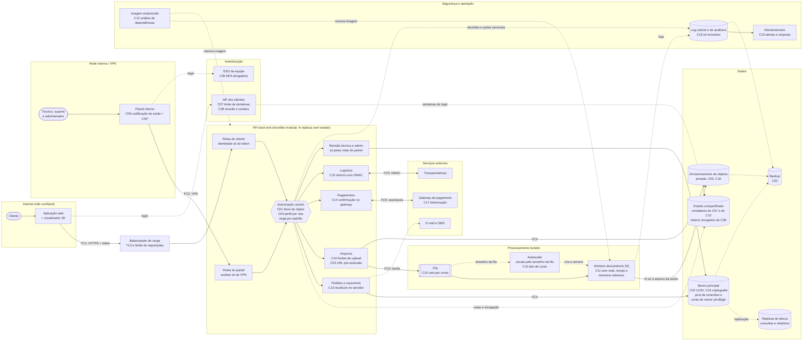
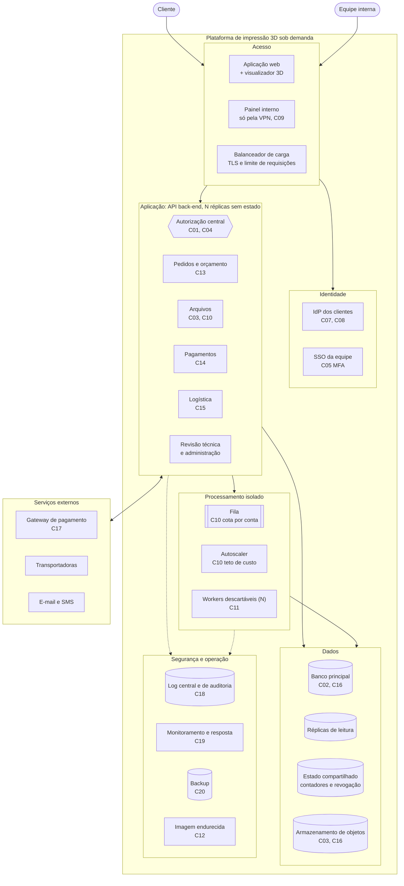

# Etapa 3 — Projeto de uma Arquitetura Segura

Esta etapa transforma os riscos e os controles da [Etapa 2](etapa-2-riscos-nist.md) em requisitos de segurança e decisões de arquitetura. Foi escolhido um risco crítico de cada grupo da [seção 3.1 da Etapa 2][e2-31]:

* **Grupo A, permissão por objeto: [R14].** O vazamento de um projeto não pode ser desfeito e pode atingir todos os clientes.
* **Grupo B, painel interno e privilégios: [R22].** A interface só esconde a opção de aprovar, e o servidor não confere quem faz o pedido.
* **Grupo C, disponibilidade do processamento: [R20].** Sem processamento, nenhum cliente consegue orçar nem comprar.

Os requisitos e as decisões detalham os controles da onda 1 da [ordem de implementação da Etapa 2][e2-46] ([C01] a [C05], [C10] e [C11]). Essa ordem continua valendo. Os limites numéricos (tamanhos, prazos e quantidades) são propostas do grupo, como na Etapa 2.

## 1. Requisitos de segurança

|ID|Risco de origem|Requisito de segurança|Critério de verificação|Controles da Etapa 2|
|-|-|-|-|-|
|RS01|[R14] (Crítico): um usuário baixa STL de outros clientes trocando o identificador na URL|A API deverá obter a identidade do usuário apenas do token de sessão validado e ignorar qualquer identificador de usuário enviado na requisição. Antes de gerar a URL pré-assinada de um STL ou PDF, deverá conferir se o arquivo pertence a um pedido desse usuário ou a um pedido atribuído ao técnico que o solicita. A URL valerá por 5 minutos, e o armazenamento não terá nenhum objeto público|O cliente A pede o arquivo de um pedido do cliente B, recebe 403 e a tentativa fica no log; um `user_id` de outro cliente colocado no corpo ou na URL é ignorado; uma URL usada depois de 5 minutos é recusada; um acesso direto ao armazenamento, sem assinatura, recebe 403|[C01], [C02], [C03]|
|RS02|[R22] (Crítico): um cliente aprova a revisão técnica da própria peça ou acessa funções administrativas|As rotas de aprovação técnica, edição de laudo e administração deverão existir só na API do painel interno, acessível apenas pela VPN ou pela lista de IPs da empresa. Em toda requisição, o servidor deverá conferir o perfil do usuário e, nas aprovações, se o pedido está atribuído a ele, negando tudo o que não estiver explicitamente permitido. Campos de status enviados pelo cliente, como `aprovado` ou `status`, deverão ser ignorados|Um cliente autenticado chama a rota de aprovação com o próprio token, recebe 403 e o evento é registrado; a mesma rota não responde a requisições vindas da internet; um `"status": "aprovado"` enviado pelo cliente não altera o pedido; um teste automatizado percorre todas as rotas da API e falha se alguma não declarar os perfis permitidos|[C01], [C04], [C05]|
|RS03|[R20] (Crítico): muitos modelos de alta densidade enviados ao mesmo tempo sobrecarregam renderização, fatiamento e DFM|Antes de gravar o arquivo e de criar a tarefa, a API deverá conferir o formato real do STL pela estrutura do arquivo, e não pela extensão (no STL binário, o tamanho precisa ser `84 + 50 * n`, sendo `n` o número de triângulos declarado no cabeçalho). Também deverá conferir o tamanho máximo de 100 MB e o limite de 2 milhões de triângulos. Cada conta poderá ter no máximo 3 tarefas simultâneas, e cada tarefa terá tempo e memória máximos. Se a fila lotar ou os workers ficarem indisponíveis, o orçamento ficará "em processamento" e nunca será liberado sem a análise DFM|Um arquivo de 150 MB recebe 413 e nada é gravado; um arquivo com extensão `.stl` e outro conteúdo é recusado; a 4ª tarefa simultânea da mesma conta fica aguardando na fila; uma tarefa que passa do tempo máximo é encerrada; com os workers parados, os orçamentos ficam "em processamento" e nenhum pedido é liberado|[C10], [C11]|

## 2. Vulnerabilidades catalogadas

Para cada requisito, a vulnerabilidade foi buscada na CWE (MITRE) e confirmada nas referências da OWASP, nas versões vigentes em outubro de 2026: OWASP Top 10:2025, OWASP API Security Top 10:2023, ASVS 5.0.0 e OWASP Cheat Sheet Series.

|Risco|Vulnerabilidade ou categoria|Referência utilizada|Relação com o sistema|
|-|-|-|-|
|[R14]|[CWE-639]: Authorization Bypass Through User-Controlled Key, conhecida como IDOR|[A01:2025] Broken Access Control, que lista a CWE-639 e cita a alteração de parâmetros na URL; [API1:2023] Broken Object Level Authorization; [ASVS 5.0.0, requisito 8.2.2][asvs-v8]: o acesso a cada item de dado é restrito a quem tem permissão explícita sobre ele, contra IDOR e BOLA; [IDOR Prevention Cheat Sheet][cs-idor]|O visualizador 3D carrega o STL por um endereço que contém o identificador do arquivo. Se o servidor não confere o dono, basta trocar esse identificador para baixar o projeto de outro cliente ([CA01]). A cheat sheet indica a conferência do dono em cada objeto e trata os IDs aleatórios só como camada extra, que é a combinação adotada no RS01 ([C01] com [C02])|
|[R22]|[CWE-602]: Client-Side Enforcement of Server-Side Security, com [CWE-285]: Improper Authorization|[A01:2025] Broken Access Control, segundo a qual o controle de acesso só é eficaz em código confiável no servidor; [API5:2023] Broken Function Level Authorization; [ASVS 5.0.0, requisitos 8.3.1 e 8.2.1][asvs-v8]: a autorização é aplicada em uma camada de serviço confiável, e cada função só é liberada a quem tem permissão explícita; [Authorization Cheat Sheet][cs-authz]: *Deny by Default* e *Validate the Permissions on Every Request*|A interface esconde o botão de aprovar, mas a rota de aprovação responde a qualquer usuário autenticado ([CA05]). O alvo é uma **função** administrativa, e não um objeto de outro cliente, por isso a categoria é BFLA (API5), e não BOLA (API1). O RS02 tira essas rotas da API pública e faz o servidor conferir o perfil em toda requisição|
|[R20]|[CWE-770]: Allocation of Resources Without Limits or Throttling, com [CWE-400]: Uncontrolled Resource Consumption|[API4:2023] Unrestricted Resource Consumption, que cita tamanho máximo de upload, tempo de execução e memória por tarefa; [ASVS 5.0.0][asvs-v5], requisitos 5.2.1 (só aceitar arquivos que possam ser processados sem negação de serviço), 5.2.2 (conferir se o conteúdo corresponde à extensão) e 5.2.4 (cota de arquivos por usuário), e [requisito 2.4.1][asvs-v2] (controles contra automação que esgota cotas e recursos caros); [A10:2025] Mishandling of Exceptional Conditions e [CWE-636]: Not Failing Securely ('Failing Open'), para o comportamento quando os workers caem; [File Upload Cheat Sheet][cs-upload]|O fatiamento e a análise DFM consomem muita CPU e memória. Sem limites, uma única conta com modelos de milhões de triângulos ocupa os workers de todos ([CA07]). O RS03 aplica os limites antes de gravar e de enfileirar, e define que a falha dos workers deixa o orçamento "em processamento", sem liberar o pedido|

## 3. Diagrama da arquitetura segura

O diagrama mostra os usuários, as interfaces, a autenticação, o ponto central de autorização, os dados, o log, o monitoramento e os serviços externos. Também aparecem os elementos que permitem escalar na horizontal: o balanceador de carga, as réplicas da API, o estado compartilhado entre elas, as réplicas de leitura do banco e o autoscaler dos workers. Cada subgrafo é uma zona de confiança, as setas FC1 a FC5 marcam onde os dados cruzam de uma zona para outra, e os rótulos C01 a C20 mostram onde ficam os controles da Etapa 2. A fonte do diagrama está em [arquitetura-segura.mmd](../diagramas/etapa-3/arquitetura-segura.mmd), com uma versão editável no draw.io em [arquitetura-segura.drawio](../diagramas/etapa-3/arquitetura-segura.drawio), e a imagem, em [arquitetura-segura.png](../diagramas/etapa-3/arquitetura-segura.png). A [seção 3.2](#32-visão-em-blocos-de-construção) mostra a mesma arquitetura dividida em blocos de construção.

### 3.1 Fronteiras de confiança

Todo dado que cruza uma fronteira de confiança é tratado como não confiável e validado no ponto de entrada.

|ID|Fronteira|O que muda ao cruzar|Controles na passagem|
|-|-|-|-|
|FC1|Navegador do cliente → balanceador e rotas do cliente na API|O dado sai de um dispositivo que o usuário controla por completo, inclusive com proxy ou script, e entra no servidor|Identidade obtida só do token ([RS01](#1-requisitos-de-segurança)); dono do objeto conferido ([C01]); preço recalculado no servidor ([C13]); limites de upload ([C10]); limite de requisições no balanceador|
|FC2|Painel interno → rotas do painel na API|Entram ações privilegiadas: aprovações, laudos, preços e contas|VPN ou lista de IPs e SSO com MFA ([C05]); perfil conferido por rota ([C04]); codificação de saída e CSP no painel ([C09])|
|FC3|API → fila e workers|Um arquivo enviado por qualquer cliente passa a ser lido por bibliotecas de terceiros|Formato, tamanho e número de triângulos conferidos antes de enfileirar ([C10]); workers sem rede, sem root e com credencial válida só para o arquivo da tarefa ([C11])|
|FC4|API → banco e armazenamento|A aplicação passa a tocar nos dados de todos os clientes|Conta do banco com menor privilégio, limitada às tabelas e aos comandos de cada módulo; UUID ([C02]); armazenamento privado com URL pré-assinada ([C03]); criptografia em repouso ([C16])|
|FC5|Serviços externos → API|Mensagens de terceiros mudam o estado do pedido, como "pago" ou "entregue"|Notificação do gateway com assinatura validada ([C14]); retorno da transportadora com HMAC ([C15]); cartão tokenizado pelo gateway ([C17])|

### 3.2 Visão em blocos de construção

Esta visão deixa os fluxos de lado e mostra como o sistema se divide em blocos, cada um com uma responsabilidade. As setas indicam só quem depende de quem. A fonte está em [blocos-de-construcao.mmd](../diagramas/etapa-3/blocos-de-construcao.mmd), com uma versão editável no draw.io em [blocos-de-construcao.drawio](../diagramas/etapa-3/blocos-de-construcao.drawio), e a imagem, em [blocos-de-construcao.png](../diagramas/etapa-3/blocos-de-construcao.png).

|Bloco|Responsabilidade|Controles|Como escala|
|-|-|-|-|
|Acesso|Recebe o tráfego de clientes e da equipe: aplicação web, painel interno e balanceador de carga|[C09]; limite de requisições no balanceador|A aplicação web é feita de arquivos estáticos, servidos por várias instâncias. O balanceador é um serviço gerenciado. O painel tem pouco tráfego e roda em duas réplicas, pela disponibilidade|
|Identidade|Autentica clientes (IdP) e equipe interna (SSO com MFA)|[C05], [C07], [C08]|Serviço gerenciado. Os contadores de tentativas ficam no estado compartilhado, para valer em todas as instâncias|
|Aplicação|Regras de negócio, divididas em módulos que ficam atrás da autorização central|[C01], [C03], [C04], [C13], [C14], [C15]|Réplicas iguais e sem estado atrás do balanceador. O monólito escala inteiro, o que basta porque a parte cara do sistema fica no bloco de processamento|
|Processamento isolado|Renderização, fatiamento e DFM de arquivos não confiáveis|[C10], [C11]|É o principal ponto de escala. O autoscaler cria e remove workers conforme o tamanho da fila, até o teto de custo|
|Dados|Registros dos pedidos, arquivos dos clientes e estado compartilhado entre as réplicas|[C02], [C03], [C16]|O armazenamento de objetos escala sozinho. Consultas e relatórios vão para réplicas de leitura. As gravações ficam no banco principal, que cresce na vertical, e o estado compartilhado roda em cluster|
|Segurança e operação|Log central e de auditoria, monitoramento, backup e a imagem base de todas as instâncias|[C12], [C18], [C19], [C20]|O volume de logs cresce com o número de instâncias. Log e monitoramento são serviços centrais, para não depender de nenhuma instância|
|Serviços externos|Pagamento, frete e notificações|[C14], [C15], [C17]|Ficam fora do controle da plataforma. A escala depende dos limites de cada parceiro|

**Monólito modular.** A API é um único sistema dividido em módulos (pedidos e orçamento, arquivos, pagamentos, logística, revisão técnica). Cada módulo só acessa os dados pela própria interface, e todos passam pelo mesmo ponto de autorização. Essa separação não exige microsserviços. Os workers são a exceção: rodam fora da API porque processam arquivos não confiáveis e precisam de isolamento próprio (FC3).

**Log de auditoria.** Cada registro do log ([C18]) tem os campos que permitem reconstruir a ação: quem executou, o alvo, a operação, a justificativa (obrigatória nas exceções, como uma aprovação fora do fluxo normal), o horário em UTC, o estado anterior, o novo estado e o resultado.

### 3.3 Escala horizontal e seus efeitos na segurança

A plataforma escala adicionando cópias dos componentes, e não trocando as máquinas por outras maiores. Isso funciona porque nenhuma instância guarda estado próprio:

* os arquivos ficam no armazenamento de objetos, e não no disco de um servidor, então qualquer réplica da API ou qualquer worker acessa o mesmo STL;
* a URL pré-assinada ([C03]) entrega o download direto do armazenamento, e o tráfego pesado dos STL nem passa pela API;
* a identidade vem do token ([RS01]), então qualquer réplica pode atender qualquer requisição.

O principal ponto de escala é o processamento. Cada tarefa é independente, e o autoscaler sobe mais workers para consumir a mesma fila. O critério é o tamanho da fila ou o tempo de espera, e não a CPU da API. A exceção é o banco principal: as gravações continuam nele, que cresce na vertical. Como os arquivos ficam no armazenamento de objetos e o banco guarda só os registros, isso deve aguentar bastante tempo antes de ser preciso dividir o banco.

Com várias instâncias, alguns controles da Etapa 2 só funcionam se o estado deles for compartilhado:

* **Contadores centrais:** o limite de tentativas de login ([C07]) e a cota por conta ([C10]) ficam no estado compartilhado. Se cada réplica contasse sozinha, um atacante distribuiria as tentativas entre as réplicas, e cada uma veria só uma fração delas.
* **Revogação em todas as réplicas:** um token revogado no logout ou depois de um incidente ([C08]) entra em uma lista no estado compartilhado, consultada por todas as réplicas. Os tokens também têm validade curta, para limitar o tempo de uso de um token roubado.
* **Teto de custo:** o autoscaler tem um limite de workers e de gasto ([C10]). Sem esse teto, um ataque de carga ([R20]) não derrubaria o sistema, mas viraria uma conta de nuvem enorme, a chamada *denial of wallet*. Quando o teto é atingido, vale a falha segura da [D03](#d03--processamento-assíncrono-com-workers-isolados-e-falha-segura): os orçamentos ficam "em processamento" e nada é liberado sem DFM.
* **Instâncias temporárias:** réplicas e workers são criados e destruídos o tempo todo. Por isso os logs vão para o log central ([C18]) e para o monitoramento ([C19]), já que os logs locais somem junto com a instância. Todas as instâncias nascem da mesma imagem endurecida, analisada a cada build ([C12]), para que nenhuma cópia comece com uma configuração diferente.

## 4. Decisões de arquitetura

|Decisão|Riscos tratados|Requisito|Justificativa resumida|
|-|-|-|-|
|[D01](#d01--o-servidor-decide-autorização-por-objeto-em-um-ponto-único)|[R06], [R14], [R16], [R17]|[RS01]|Esconder dados na interface não impede que o cliente peça o recurso de outro. Só o servidor pode decidir quem acessa cada objeto|
|[D02](#d02--painel-interno-separado-com-defesa-em-profundidade)|[R03], [R22], [R24]|[RS02]|Ocultar opções na interface não impede o acesso direto às funções. As rotas administrativas saem da API pública e passam a exigir várias camadas|
|[D03](#d03--processamento-assíncrono-com-workers-isolados-e-falha-segura)|[R19], [R20], [R21], [R26]|[RS03]|Sem fila nem isolamento, um único cliente derruba ou compromete o processamento de todos|

#### D01 — O servidor decide: autorização por objeto em um ponto único

**Problema ou risco tratado:** [R14], [R06], [R16] e [R17], do grupo A da Etapa 2 ([RS01]). Os números de pedido são sequenciais e o servidor não confere o dono do recurso. Assim, um usuário autenticado consegue ler ou alterar pedidos, arquivos e laudos de outros clientes ([CA01], [CA06]).

**Decisão:**

* O cliente só envia a intenção: o que quer fazer e sobre qual recurso. A identidade do usuário vem do token validado no servidor, nunca de um campo da requisição.
* Toda rota passa pelo módulo de autorização central antes de chegar ao módulo de negócio. Esse módulo carrega o recurso, confere se ele pertence ao usuário (ou se o pedido está atribuído ao técnico) e nega tudo o que não estiver explicitamente permitido.
* Pedidos, arquivos e laudos usam UUID. Os arquivos só são entregues por URL pré-assinada de 5 minutos, gerada depois dessa conferência.

**Motivo:**

* **Cliente solicita, servidor decide:** o navegador está fora do controle da plataforma (FC1), e qualquer campo enviado por ele pode ser alterado com um proxy.
* **Negação por padrão e mediação completa:** se cada rota fizesse a própria verificação, bastaria uma rota esquecida para o IDOR continuar. Com um ponto único, a regra é aplicada em toda requisição e pode ser testada de uma vez.
* O UUID não substitui a conferência do dono (a [IDOR Prevention Cheat Sheet][cs-idor] trata IDs aleatórios só como camada extra), mas impede a enumeração em massa por script. Trocar o formato depois exigiria migrar os dados e quebraria links já enviados aos clientes.

**Componente afetado:** API back-end (módulo de autorização e rotas do cliente), banco de dados (chaves em UUID) e armazenamento de arquivos (sem objetos públicos).

**Resultado esperado:** cada usuário só alcança os próprios pedidos, arquivos e laudos. Uma tentativa de acessar recursos de outro cliente recebe 403 e fica no log ([C18]). Tentativas repetidas disparam o alerta de enumeração ([C19]).

#### D02 — Painel interno separado, com defesa em profundidade

**Problema ou risco tratado:** [R22], [R03] e [R24], do grupo B da Etapa 2 ([RS02]). A interface só esconde a opção de aprovar ([CA05]), o painel não exige MFA nem restringe a rede de acesso ([CA08]), e o conteúdo enviado por clientes aparece no painel sem codificação.

**Decisão:**

* O painel tem endereço próprio e usa rotas próprias na API. As rotas de aprovação, laudo e administração não existem entre as rotas usadas pelos clientes.
* O acesso tem quatro camadas: VPN ou lista de IPs, SSO com MFA, perfil e atribuição conferidos em cada rota e log de auditoria com alerta de acesso fora do padrão.
* As permissões seguem o menor privilégio (matriz abaixo), e a aprovação de um projeto exige o técnico atribuído ao pedido.

**Motivo:**

* **Redução da superfície de ataque:** uma rota que não existe na API pública não pode ser chamada pela internet, mesmo por quem tem um token válido.
* **Defesa em profundidade:**
  * uma senha de técnico vazada esbarra no MFA;
  * quem consegue passar do MFA ainda precisa estar na rede interna;
  * dentro da rede, o perfil limita o que pode ser feito;
  * e o log registra a ação e dispara o alerta.

  O [ASVS 5.0.0, requisito 8.4.2][asvs-v8] pede essas várias camadas para interfaces administrativas, sem depender só da localização na rede.
* **Separação de funções:** quem cuida da infraestrutura não tem autoridade sobre laudos e aprovações, e cada aprovação é feita por uma pessoa identificada, com conta pessoal ([C06]).

**Matriz de menor privilégio**

|Perfil|Pode|Não pode|
|-|-|-|
|Cliente|Enviar arquivos, configurar, pagar, acompanhar, cancelar e avaliar os próprios pedidos|Ver pedidos e arquivos de outros clientes, aprovar a revisão técnica, alterar preços ou o status de produção|
|Atendente de suporte|Consultar pedidos, responder chamados e trocar o endereço de entrega depois de confirmar pelo canal cadastrado ([C21])|Baixar STL e PDF dos clientes, aprovar projetos, alterar preços e descontos|
|Técnico de produção|Abrir os arquivos dos pedidos atribuídos a ele, emitir o laudo DFM, aprovar ou reprovar esses projetos e atualizar o status de produção|Acessar pedidos não atribuídos a ele, alterar preços, criar contas|
|Administrador|Gerenciar preços, descontos, materiais, estoque e contas internas, com aprovação da segurança para novos perfis ([C06])|Aprovar projetos ou editar laudos|
|Infraestrutura/DevOps|Manter servidores, banco, fila e workers e consultar métricas|Aprovar projetos, editar laudos ou alterar pedidos, mesmo com acesso técnico ao banco|

**Componente afetado:** painel interno, serviço de autenticação (SSO), rotas do painel na API e log de auditoria.

**Resultado esperado:** as funções administrativas deixam de ser alcançáveis pela internet. Uma credencial vazada, sozinha, não dá acesso ao painel. Toda aprovação tem um autor identificado no log.

#### D03 — Processamento assíncrono com workers isolados e falha segura

**Problema ou risco tratado:** [R20], [R19], [R21] e [R26], do grupo C da Etapa 2 ([RS03]). Renderização, fatiamento e DFM rodam sem fila nem limites, e bibliotecas de terceiros leem arquivos enviados por qualquer cliente em servidores com acesso amplo ao armazenamento ([CA02], [CA07]).

**Decisão:**

* O upload só é aceito depois de a API conferir o formato real, o tamanho e o número de triângulos. O arquivo aceito vira uma tarefa em uma fila com cota por conta.
* As tarefas rodam em workers descartáveis: contêineres sem rede, sem root, com tempo e memória máximos e uma credencial que só lê o arquivo daquela tarefa. Os PDFs do RF22 são convertidos em imagem no mesmo ambiente.
* Os workers escalam na horizontal: o autoscaler cria e remove contêineres conforme o tamanho da fila, até o teto de custo do [C10] ([seção 3.3](#33-escala-horizontal-e-seus-efeitos-na-segurança)).
* O orçamento passa a ter o estado "em processamento". Se a fila lotar ou os workers caírem, o pedido espera nesse estado e nada é aprovado sem o resultado do DFM. Quando o serviço volta, as tarefas são reprocessadas na ordem de chegada.

**Motivo:**

* **Falha segura:** diante de uma falha, o sistema nega em vez de liberar. Liberar o orçamento sem DFM levaria à produção de peças inviáveis, e mostrar o erro técnico ao cliente exporia detalhes internos ([A10:2025]).
* **Contenção do impacto:** se um STL malicioso conseguir executar código, ele fica preso em um contêiner sem rede, que só enxerga um arquivo e é destruído ao fim da tarefa. É isso que reduz o impacto do [R21] de 4 para 2 no risco residual da Etapa 2.
* **Limites antes da fila:** conferir o arquivo antes de gravar e de enfileirar evita gastar armazenamento e CPU com arquivos que seriam recusados depois.
* Trocar o processamento imediato pela fila muda o contrato da API e a interface, que passa a mostrar o estado "em processamento". Por isso, a decisão precisa ser tomada agora, antes do código.

**Componente afetado:** API (módulos de arquivos e de orçamento), fila, autoscaler, workers, armazenamento e aplicação web (exibição do estado "em processamento").

**Resultado esperado:** sob carga, o sistema fica mais lento, mas continua aceitando pedidos e orçamentos. Nenhum orçamento é liberado sem DFM, e uma falha no fatiador não alcança os arquivos dos outros clientes.

[e2-31]: etapa-2-riscos-nist.md#31-riscos-críticos-12-a-16
[e2-46]: etapa-2-riscos-nist.md#46-ordem-inicial-de-implementação

[RS01]: #1-requisitos-de-segurança
[RS02]: #1-requisitos-de-segurança
[RS03]: #1-requisitos-de-segurança

[R03]: etapa-2-riscos-nist.md#22-registro-de-riscos
[R06]: etapa-2-riscos-nist.md#22-registro-de-riscos
[R14]: etapa-2-riscos-nist.md#22-registro-de-riscos
[R16]: etapa-2-riscos-nist.md#22-registro-de-riscos
[R17]: etapa-2-riscos-nist.md#22-registro-de-riscos
[R19]: etapa-2-riscos-nist.md#22-registro-de-riscos
[R20]: etapa-2-riscos-nist.md#22-registro-de-riscos
[R21]: etapa-2-riscos-nist.md#22-registro-de-riscos
[R22]: etapa-2-riscos-nist.md#22-registro-de-riscos
[R24]: etapa-2-riscos-nist.md#22-registro-de-riscos
[R26]: etapa-2-riscos-nist.md#22-registro-de-riscos

[C01]: etapa-2-riscos-nist.md#c01
[C02]: etapa-2-riscos-nist.md#c02
[C03]: etapa-2-riscos-nist.md#c03
[C04]: etapa-2-riscos-nist.md#c04
[C05]: etapa-2-riscos-nist.md#c05
[C06]: etapa-2-riscos-nist.md#c06
[C07]: etapa-2-riscos-nist.md#c07
[C08]: etapa-2-riscos-nist.md#c08
[C09]: etapa-2-riscos-nist.md#c09
[C10]: etapa-2-riscos-nist.md#c10
[C11]: etapa-2-riscos-nist.md#c11
[C12]: etapa-2-riscos-nist.md#c12
[C13]: etapa-2-riscos-nist.md#c13
[C14]: etapa-2-riscos-nist.md#c14
[C15]: etapa-2-riscos-nist.md#c15
[C16]: etapa-2-riscos-nist.md#c16
[C17]: etapa-2-riscos-nist.md#c17
[C18]: etapa-2-riscos-nist.md#c18
[C19]: etapa-2-riscos-nist.md#c19
[C20]: etapa-2-riscos-nist.md#c20
[C21]: etapa-2-riscos-nist.md#c21

[CA01]: etapa-1-ameacas-stride.md#ca01--roubo-de-projeto-confidencial
[CA02]: etapa-1-ameacas-stride.md#ca02--arquivo-stl-malicioso
[CA05]: etapa-1-ameacas-stride.md#ca05--autoaprovação-da-revisão-técnica
[CA06]: etapa-1-ameacas-stride.md#ca06--cancelamento-de-pedidos-de-outros-clientes
[CA07]: etapa-1-ameacas-stride.md#ca07--sobrecarga-do-processamento-de-modelos
[CA08]: etapa-1-ameacas-stride.md#ca08--falso-técnico-aprova-peça-adulterada

[CWE-285]: https://cwe.mitre.org/data/definitions/285.html
[CWE-400]: https://cwe.mitre.org/data/definitions/400.html
[CWE-602]: https://cwe.mitre.org/data/definitions/602.html
[CWE-636]: https://cwe.mitre.org/data/definitions/636.html
[CWE-639]: https://cwe.mitre.org/data/definitions/639.html
[CWE-770]: https://cwe.mitre.org/data/definitions/770.html
[A01:2025]: https://top10.owasp.org/2025/A01_2025-Broken_Access_Control/
[A10:2025]: https://top10.owasp.org/2025/A10_2025-Mishandling_of_Exceptional_Conditions/
[API1:2023]: https://api-security.owasp.org/editions/2023/en/0xa1-broken-object-level-authorization/
[API4:2023]: https://api-security.owasp.org/editions/2023/en/0xa4-unrestricted-resource-consumption/
[API5:2023]: https://api-security.owasp.org/editions/2023/en/0xa5-broken-function-level-authorization/
[asvs-v2]: https://github.com/OWASP/ASVS/blob/v5.0.0/5.0/en/0x11-V2-Validation-and-Business-Logic.md
[asvs-v5]: https://github.com/OWASP/ASVS/blob/v5.0.0/5.0/en/0x14-V5-File-Handling.md
[asvs-v8]: https://github.com/OWASP/ASVS/blob/v5.0.0/5.0/en/0x17-V8-Authorization.md
[cs-authz]: https://cheatsheetseries.owasp.org/cheatsheets/Authorization_Cheat_Sheet.html
[cs-idor]: https://cheatsheetseries.owasp.org/cheatsheets/Insecure_Direct_Object_Reference_Prevention_Cheat_Sheet.html
[cs-upload]: https://cheatsheetseries.owasp.org/cheatsheets/File_Upload_Cheat_Sheet.html
