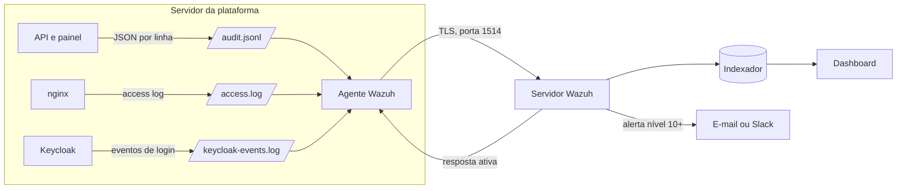

# Etapa 6 — Monitoramento e Detecção de Intrusões

Este roteiro descreve como a plataforma perceberia um ataque depois de entrar em operação, usando o [Wazuh] como SIEM. O Wazuh coleta os logs, aplica regras de correlação, gera alertas e pode disparar respostas automáticas. Como o enunciado permite, ele não foi instalado: o roteiro mostra a configuração proposta. A base, porém, já existe no código: cada evento de segurança da [Etapa 4](../codigo/etapa-4/) sai como uma linha JSON, que o Wazuh lê sem decodificador próprio. A seção 7 diz o que já roda no repositório.

## 1. O que é detecção de intrusões

Detecção de intrusões é observar o sistema em operação para encontrar sinais de que alguém está tentando contornar as proteções, ou já contornou. Os sinais vêm dos registros que o próprio sistema produz: logs de autenticação, negações de acesso, erros, requisições e eventos de negócio. Uma regra de detecção descreve um padrão suspeito nesses registros, e um alerta avisa a equipe quando o padrão aparece.

Um SIEM (*Security Information and Event Management*) junta esses registros em um lugar só, fora dos servidores que os produziram, e correlaciona eventos de fontes diferentes. O Wazuh é um SIEM de código aberto, com quatro partes:

|Parte|Papel|
|-|-|
|Agente|Roda no servidor monitorado, lê os arquivos de log e os envia ao servidor do Wazuh|
|Servidor (manager)|Decodifica cada linha, aplica as regras e gera os alertas. Também dispara as respostas ativas|
|Indexador|Guarda os alertas e os eventos para busca|
|Dashboard|Interface web para consultar alertas, eventos e relatórios|

A detecção aqui é feita sobretudo sobre a aplicação, e não só sobre a rede. Os ataques que mais importam para a plataforma, como a enumeração de projetos ([CA01]) e o falso técnico no painel ([CA08]), usam requisições válidas, com token válido. Para um IDS de rede, são tráfego normal. Só a aplicação sabe que o pedido era de outro cliente ou que o acesso foi às três da manhã, e por isso os eventos dela são a principal fonte do Wazuh.

## 2. Prevenir e detectar

|Prevenir|Detectar|
|-|-|
|Impede o ataque no momento da requisição|Percebe o ataque pelo conjunto das requisições|
|Olha uma requisição por vez|Olha padrões ao longo do tempo e por conta|
|Responde na hora: 401, 403, 413, 422, 429|Responde depois: avisa a equipe, que investiga e contém|
|Exemplo: a [D01] nega o arquivo de outro cliente|Exemplo: a regra 1 percebe que a mesma conta já recebeu 10 negações em 5 minutos|

As duas se completam. Uma única negação é esperada, porque um cliente pode errar um link. Dezenas delas, para a mesma conta e em poucos minutos, mostram um script percorrendo IDs. A prevenção já barrou cada tentativa, mas só a detecção revela que alguém está procurando uma brecha, e é ela que cobre o caso em que um controle falha. A [Etapa 5](../docs/etapa-5-verificacao-vulnerabilidades.md) mostrou que controles falham: o estouro de inteiro no preço passou pela aplicação inteira.

## 3. Eventos registrados

### 3.1 Eventos da aplicação

A API, o painel e o serviço de retenção gravam cada evento de segurança em dois lugares: no banco de auditoria, em que as aplicações só têm permissão de `INSERT` ([C18]), e no stdout, como uma linha JSON ([audit.go](../codigo/etapa-4/internal/audit/audit.go)):

```json
{"time":"2026-11-20T03:12:09Z","event":"authz.denied","actor":"7f1c…","action":"file.read","target":"0193…","result":"denied","origin":"203.0.113.7"}
```

Os campos são os da seção 3.2 da [Etapa 3](../docs/etapa-3-arquitetura-segura.md): autor, alvo, operação, horário UTC, origem (o IP do cliente), resultado e motivo. Tokens, senhas, dados de cartão e conteúdo de arquivos nunca entram no registro ([C17]). O catálogo tem 38 eventos ([E7.1 do backlog](../codigo/etapa-4/BACKLOG.md)), e os que alimentam a detecção são estes:

|Evento|Quando acontece|Risco ou caso de abuso|
|-|-|-|
|`authz.denied`|O usuário pede um arquivo, pedido ou chamado que não é dele|[R14], [R16], [CA01]|
|`upload.rejected`|O upload é recusado por tamanho, formato ou número de triângulos|[R19], [R20], [CA07]|
|`quota.waiting`|A conta já tem 3 tarefas em processamento e a nova espera na fila|[R20], [CA07]|
|`rate.limited`|A conta passa de 60 requisições por minuto|[R18], [R19]|
|`token.revoked` e `auth.revoked_token_used`|Um token é revogado no logout, e depois alguém tenta usá-lo|[R01]|
|`panel.access`|Qualquer requisição autenticada ao painel interno|[R03], [CA08]|
|`panel.critical`|Uma das operações críticas da [D02]: download de STL ou PDF, aprovação de tabela de preço, troca de endereço, revogação|[R03], [R12], [CA08]|
|`payment.rejected` e `shipment.rejected`|Notificação do gateway ou da transportadora recusada, por exemplo por assinatura inválida|[R04], [R23]|
|`user.revoked`|Um administrador revoga um usuário durante a resposta a um incidente|Registro da própria resposta|

### 3.2 Como os eventos chegam ao Wazuh



Hoje os eventos vão para o stdout de cada contêiner. A única mudança proposta no sistema é gravá-los também em um arquivo, em um volume que o agente lê. Como o `audit.Logger` recebe um `io.Writer`, basta passar um `io.MultiWriter` com o stdout e o arquivo. O nginx e o Keycloak fazem o mesmo com os logs de acesso e de login. O agente lê os arquivos assim, no `ossec.conf`:

```xml
<localfile>
  <log_format>json</log_format>
  <location>/var/log/nuggetmachine/audit.jsonl</location>
  <label key="app">nuggetmachine</label>
</localfile>
<localfile>
  <log_format>syslog</log_format>
  <location>/var/log/nuggetmachine/nginx/access.log</location>
</localfile>
```

O servidor do Wazuh fica fora da rede da plataforma, com credenciais próprias. Assim, um invasor que tome a aplicação não consegue apagar os alertas já enviados, o que reforça o [C18] contra o [R25].

### 3.3 Outras fontes

Além dos eventos da aplicação, o Wazuh traz módulos que cobrem riscos da Etapa 2 sem regra nova:

|Fonte|Módulo do Wazuh|O que detecta|
|-|-|-|
|Log de acesso do nginx|Regras nativas de servidor web|Muitos erros 4xx da mesma origem, varreduras de caminhos e tentativas de injeção na URL ([R19])|
|Eventos de login do Keycloak|Decodificador próprio para os eventos `LOGIN_ERROR`|Força bruta e credenciais vazadas ([R01], [R18])|
|Configuração do nginx, `compose.yaml` e pasta de segredos|Monitoramento de integridade de arquivos (FIM)|Alteração não autorizada da configuração ou dos segredos ([R25])|
|Pacotes do servidor|Detecção de vulnerabilidades|Pacotes com CVE conhecida, como as do nginx que o Trivy achou na Etapa 5 ([C12])|

## 4. Regras de detecção

As regras próprias ficam em `/var/ossec/etc/rules/local_rules.xml`, com IDs a partir de 100000, a faixa reservada pelo Wazuh para regras locais. O decodificador JSON nativo transforma cada campo do evento em um campo da regra (`event`, `actor`, `origin`), e uma regra base agrupa os eventos da plataforma. As três regras pedidas pelo enunciado são estas:

|Regra|Risco observado|Fonte de dados|Condição de alerta|Resposta inicial|
|-|-|-|-|-|
|1. Enumeração de IDs (100111)|[R14] e [R16]: alguém percorre IDs para baixar projetos ou ver pedidos de outros clientes ([CA01])|Eventos `authz.denied` do log de auditoria|10 negações para a mesma conta em 5 minutos|Alerta de nível 10 por e-mail. A equipe revoga a conta pelo painel e confere no log quais IDs ela pediu e se algum pedido foi atendido|
|2. Abuso de upload (100121)|[R19] e [R20]: uma conta envia arquivos inválidos em série ou esgota a cota de processamento de propósito ([CA07])|Eventos `upload.rejected` e `quota.waiting`|10 uploads recusados ou esperas de cota da mesma conta em 10 minutos|Alerta de nível 10. A equipe confere a fila e os workers, e revoga a conta se os arquivos não fizerem sentido para um cliente real|
|3. Acesso ao painel fora do horário (100130)|[R03]: credenciais de um técnico ou administrador nas mãos de outra pessoa ([CA08])|Eventos `panel.access`|Qualquer acesso ao painel entre 20h e 7h|Alerta de nível 12. A equipe confirma o acesso com o titular por outro canal e, se ele não o reconhecer, revoga a conta e revisa as ações dela|

Os limites vieram do uso esperado. Um cliente que erra um link recebe uma ou duas negações, e não dez em cinco minutos. A cota é de 3 tarefas simultâneas, então dez esperas em dez minutos indicam envio em massa. A produção trabalha em horário comercial, e um acesso noturno é raro o bastante para merecer uma pergunta.

As regras em XML:

```xml
<group name="nuggetmachine,">

  <!-- Base: todo evento de auditoria da plataforma. Nível 0 não gera alerta. -->
  <rule id="100100" level="0">
    <decoded_as>json</decoded_as>
    <field name="event">\.+</field>
    <field name="actor">\.+</field>
    <description>Evento de auditoria da plataforma</description>
  </rule>

  <!-- Regra 1: enumeração de IDs (CA01, R14, R16) -->
  <rule id="100110" level="3">
    <if_sid>100100</if_sid>
    <field name="event">^authz.denied$</field>
    <description>Acesso negado a objeto de outro cliente: $(actor)</description>
    <group>authz,</group>
  </rule>

  <rule id="100111" level="10" frequency="10" timeframe="300">
    <if_matched_sid>100110</if_matched_sid>
    <same_field>actor</same_field>
    <description>Possível enumeração de IDs pela conta $(actor)</description>
    <group>authz,enumeration,</group>
  </rule>

  <!-- Regra 2: abuso de upload (CA07, R19, R20) -->
  <rule id="100120" level="3">
    <if_sid>100100</if_sid>
    <field name="event">^upload.rejected$|^quota.waiting$</field>
    <description>Upload recusado ou espera de cota: $(actor)</description>
    <group>upload,</group>
  </rule>

  <rule id="100121" level="10" frequency="10" timeframe="600">
    <if_matched_sid>100120</if_matched_sid>
    <same_field>actor</same_field>
    <description>Abuso de upload pela conta $(actor)</description>
    <group>upload,dos,</group>
  </rule>

  <!-- Regra 3: acesso ao painel fora do horário (CA08, R03) -->
  <rule id="100130" level="12">
    <if_sid>100100</if_sid>
    <field name="event">^panel.access$</field>
    <time>8 pm - 7 am</time>
    <description>Acesso ao painel fora do horário pela conta $(actor)</description>
    <group>panel,</group>
  </rule>

</group>
```

Três detalhes da sintaxe sustentam as regras:

* **`frequency`, `timeframe` e `same_field`:** a regra 100111 só dispara quando a 100110 casou 10 vezes em 300 segundos **com o mesmo `actor`**. Sem o `same_field`, dez clientes diferentes errando um link cada um disparariam o alerta.
* **`if_matched_sid` e `if_sid`:** `if_sid` encadeia uma regra na outra para o mesmo evento, e `if_matched_sid` olha para trás, contando eventos anteriores que casaram a regra filha.
* **`time`:** o horário é o do servidor do Wazuh, que precisa estar no fuso de Brasília (`TZ=America/Sao_Paulo`). O campo `time` do evento está em UTC e não é o que a regra usa.

Duas regras extras completam o conjunto, com a mesma estrutura:

|Regra|Condição de alerta|Risco|
|-|-|-|
|Operações críticas em série no painel (100141)|Mais de 4 eventos `panel.critical` da mesma conta em 10 minutos|[R03], [CA08]: alguém baixa projetos ou troca endereços em lote|
|Webhooks com assinatura inválida (100151)|Mais de 4 eventos `payment.rejected` ou `shipment.rejected` com motivo `invalid_signature` da mesma origem em 10 minutos|[R04], [R23]: tentativa de forjar um pagamento ou uma entrega|

## 5. O que acontece depois de um alerta

### 5.1 Notificação

Todo alerta de nível 10 ou mais vai por e-mail e para um canal do Slack, pela integração nativa do Wazuh:

```xml
<integration>
  <name>slack</name>
  <hook_url>https://hooks.slack.com/services/...</hook_url>
  <level>10</level>
  <alert_format>json</alert_format>
</integration>
```

A URL do webhook é um segredo e fica no cofre, como as demais chaves da [Etapa 3](../docs/etapa-3-arquitetura-segura.md).

### 5.2 Resposta

A resposta segue o plano do [C19], em cinco passos:

1. **Triagem.** Quem está de plantão abre o alerta no dashboard do Wazuh, que mostra a conta, o IP de origem e os eventos que levaram a ele. A pergunta é se o padrão tem explicação legítima: um cliente com um link quebrado em um script, um técnico que avisou que faria hora extra.
2. **Contenção.** Se não houver explicação, um administrador revoga o usuário pelo painel (`POST /panel/v1/users/{id}/revoke`). A revogação corta na hora todos os tokens da conta, em todas as réplicas da API, e depois desativa a conta e encerra as sessões no Keycloak. Por ser uma operação crítica, ela pede justificativa e gera os eventos `panel.critical` e `user.revoked`, que também chegam ao Wazuh.
3. **Investigação.** O Wazuh responde o que a conta fez e desde quando, com uma busca por `data.actor` no indexador: quais IDs pediu, quais arquivos baixou, quais pedidos alterou. O banco de auditoria guarda a mesma trilha, e as duas cópias, em lugares diferentes, precisam bater.
4. **Comunicação e recuperação.** Se algum projeto ou dado pessoal foi exposto, os clientes afetados e a ANPD são comunicados, como prevê a LGPD. Pedidos e laudos alterados voltam ao estado anterior a partir do log e do backup ([C20]). Nos vazamentos de projeto não há o que restaurar ([R14], [R17]), e por isso a resposta é conter e comunicar rápido.
5. **Aprendizado.** O incidente leva à revisão do registro de riscos ([C22]) e, se a regra demorou a disparar ou disparou à toa, ao ajuste do limite dela.

### 5.3 Resposta automática

O Wazuh pode executar um script quando uma regra dispara (*active response*). A proposta usa isso com cuidado:

|Regra|Resposta automática|Por quê|
|-|-|-|
|Webhooks com assinatura inválida|Bloquear o IP de origem no firewall por 10 minutos|O gateway e a transportadora legítimos assinam as mensagens. Quem manda várias assinaturas inválidas não é um parceiro, e o bloqueio expira sozinho|
|Enumeração de IDs|Nenhuma. Só alerta|Um cliente legítimo com uma integração mal escrita também gera negações em série. Revogá-lo automaticamente cortaria um pedido pago no meio, e a prevenção já barrou cada tentativa, então esperar alguns minutos pela triagem custa pouco|
|Acesso ao painel fora do horário|Nenhuma. Só alerta|Um técnico de plantão legítimo ficaria sem acesso no meio de um problema|

A contenção de contas continua humana, pelo painel, que exige um administrador identificado e uma justificativa.

## 6. Limitações

* As regras olham uma conta por vez. Um atacante com muitas contas, cada uma abaixo do limite, não dispara a regra 1. Uma regra com `same_field` em `origin`, somando as negações de todas as contas de um mesmo IP, cobriria parte desse caso, mas não um atacante que também troque de IP.
* A regra 3 gera um alerta por requisição ao painel fora do horário. Uma sessão noturna legítima produz dezenas deles, que o dashboard agrupa, mas que chegam um a um no Slack.
* O Wazuh vê o que a aplicação registra. Uma falha que não gera evento, como o estouro de inteiro no preço da Etapa 5, não aparece em regra nenhuma, e só as regras operacionais de erros 5xx dariam um sinal indireto.

## 7. O que já existe no repositório

O Wazuh não foi instalado, mas uma versão mais simples das mesmas regras roda no ambiente do Docker Compose, com o Grafana no lugar do SIEM:

* os eventos da seção 3.1 já são gravados no banco de auditoria e no stdout;
* o Grafana lê o banco de auditoria com um papel só de leitura e avalia a cada 10 segundos as regras 1 a 3 e as duas extras, com os mesmos limites, além de três regras operacionais sobre as métricas do Prometheus: serviço fora do ar, mais de 5% de respostas 5xx e mensagens na fila de falhas ([rules.yaml](../codigo/etapa-4/deploy/grafana/provisioning/alerting/rules.yaml));
* a revogação de usuários pelo painel, usada no passo de contenção, está implementada;
* os testes de ponta a ponta [TestEnumerationFiresTheAlert e TestUploadAbuseFiresTheAlert](../codigo/etapa-4/tests/e2e/e2e_test.go) confirmam que as regras 1 e 2 disparam para a conta certa.

Para ver funcionando, em `codigo/etapa-4/`:

```bash
just up        # sobe o sistema
just seed      # cria a demonstração, com eventos de segurança que acendem o dashboard
just grafana   # mostra o endereço do Grafana e onde fica a senha
just test-e2e  # entre outros aceites, dispara as regras 1 e 2
```

A diferença para o Wazuh é que o Grafana não sai da rede da plataforma, não notifica ninguém fora dele e não tem resposta automática. Para a operação real, o Wazuh resolve as três coisas.

[Wazuh]: https://documentation.wazuh.com/current/index.html
[CA01]: ../docs/etapa-1-ameacas-stride.md#ca01--roubo-de-projeto-confidencial
[CA07]: ../docs/etapa-1-ameacas-stride.md#ca07--sobrecarga-do-processamento-de-modelos
[CA08]: ../docs/etapa-1-ameacas-stride.md#ca08--falso-técnico-aprova-peça-adulterada
[R01]: ../docs/etapa-2-riscos-nist.md#22-registro-de-riscos
[R03]: ../docs/etapa-2-riscos-nist.md#22-registro-de-riscos
[R04]: ../docs/etapa-2-riscos-nist.md#22-registro-de-riscos
[R12]: ../docs/etapa-2-riscos-nist.md#22-registro-de-riscos
[R14]: ../docs/etapa-2-riscos-nist.md#22-registro-de-riscos
[R16]: ../docs/etapa-2-riscos-nist.md#22-registro-de-riscos
[R17]: ../docs/etapa-2-riscos-nist.md#22-registro-de-riscos
[R18]: ../docs/etapa-2-riscos-nist.md#22-registro-de-riscos
[R19]: ../docs/etapa-2-riscos-nist.md#22-registro-de-riscos
[R20]: ../docs/etapa-2-riscos-nist.md#22-registro-de-riscos
[R23]: ../docs/etapa-2-riscos-nist.md#22-registro-de-riscos
[R25]: ../docs/etapa-2-riscos-nist.md#22-registro-de-riscos
[C12]: ../docs/etapa-2-riscos-nist.md#c12
[C17]: ../docs/etapa-2-riscos-nist.md#c17
[C18]: ../docs/etapa-2-riscos-nist.md#c18
[C19]: ../docs/etapa-2-riscos-nist.md#c19
[C20]: ../docs/etapa-2-riscos-nist.md#c20
[C22]: ../docs/etapa-2-riscos-nist.md#c22
[D01]: ../docs/etapa-3-arquitetura-segura.md#d01--o-servidor-decide-autorização-por-objeto-em-um-ponto-único
[D02]: ../docs/etapa-3-arquitetura-segura.md#d02--painel-interno-separado-com-defesa-em-profundidade
