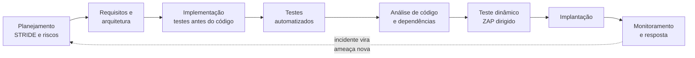

# Etapa 7 — DevSecOps e Apresentação Final

Este roteiro junta as seis etapas anteriores em um pipeline DevSecOps e traz o roteiro da apresentação final. O pipeline é uma proposta, como permite o enunciado, mas quase todos os passos dele já rodam no repositório como comandos do `just`, em `codigo/etapa-4/`. A seção 3 diz o que já existe e o que falta.

## 1. Pipeline DevSecOps proposto

A ideia é que nenhuma mudança chegue à produção sem passar pelos mesmos controles que o sistema passou ao longo da disciplina. Os dois primeiros momentos acontecem a cada funcionalidade nova, os quatro do meio a cada pull request e os dois últimos a cada versão.



|Momento|Atividade de segurança|Evidência produzida|Condição para continuar|
|-|-|-|-|
|1. Planejamento e análise de ameaças|STRIDE e casos de abuso para a funcionalidade nova, e atualização do registro de riscos|Ameaças, casos de abuso e riscos ([Etapa 1], [Etapa 2])|Todo risco crítico ou alto tem tratamento e responsável|
|2. Requisitos e decisões de arquitetura|Requisito de segurança verificável para cada risco crítico, e decisão de arquitetura quando o risco é estrutural|Requisitos RS01 a RS03 e decisões D01 a D03 ([Etapa 3])|Todo requisito tem um critério de teste|
|3. Implementação segura|Testes de segurança escritos e commitados antes do código, e revisão do pull request por outra pessoa|Testes versionados antes da implementação ([Etapa 4])|Revisão aprovada, com atenção a regra de negócio, formato de arquivo e concorrência, que as ferramentas não veem|
|4. Testes automatizados|Testes de unidade, de segurança e de ponta a ponta. Um teste percorre todas as rotas e falha se alguma não declarar os perfis permitidos|Saída do `just test`, do `just test-e2e` e do `just web-lint`|Todos os testes aprovados|
|5. Análise de código e dependências|`go vet`, `gosec`, `govulncheck`, `gitleaks` sobre todo o histórico, conferência do código gerado pelo `sqlc` e Trivy nas imagens|Saída do `just lint` e relatório do Trivy|Nenhum segredo, nenhuma falha alta ou crítica sem análise e o código gerado igual às consultas|
|6. Teste dinâmico|ZAP contra o ambiente do compose: varredura automática da API e do app, e dirigida, com token renovado e limites folgados, na API e no painel|Relatórios do ZAP e logs do servidor durante a varredura ([Etapa 5])|Todo alerta alto analisado, nenhuma resposta 500 sem explicação e poucas respostas 429|
|7. Implantação|Imagens mínimas (distroless, sem root), fixadas por digest, contêineres sem privilégios e sem escrita no disco, segredos fora do código|Imagem com digest registrado e configuração do compose|A imagem implantada é a mesma que passou pelos momentos 4 a 6|
|8. Monitoramento e resposta|Eventos de auditoria enviados ao Wazuh, regras de detecção e revogação de contas pelo painel|Alertas, eventos e registro de incidentes ([Etapa 6])|Incidentes tratados, e cada incidente revisto no registro de riscos|

A seta de volta é o que fecha o ciclo: um incidente ou um achado novo vira uma ameaça a modelar no próximo planejamento. Foi o que aconteceu na Etapa 5, quando o estouro de inteiro no preço mostrou um risco que a análise de [R07] não descrevia em detalhe.

## 2. Condições que impedem a continuidade

Qualquer uma destas condições barra o pull request ou a versão:

1. **Teste de segurança reprovado.** Inclui os testes das práticas da Etapa 4 e o teste das rotas: uma rota nova sem perfis declarados não entra.
2. **Segredo no repositório.** O `gitleaks` varre o histórico inteiro, e não só o último commit. Um segredo que entrou e saiu continua no histórico e precisa ser trocado.
3. **Dependência ou imagem com vulnerabilidade alta ou crítica sem análise.** O `govulncheck` olha as bibliotecas Go, e o Trivy olha os pacotes das imagens. Uma falha pode ser aceita, mas só com registro de quem aceitou, por quê e até quando.
4. **Alerta alto do ZAP sem análise.** O alerta precisa ser classificado como falha real ou falso positivo, com a evidência. O SQL Injection da Etapa 5 mostrou que aceitar o alerta sem análise leva a "corrigir" código certo.
5. **Varredura que não alcançou o código.** Uma rodada do ZAP com muitas respostas 429 ou 401 não vale como aprovação, porque os ataques pararam antes da aplicação. Na Etapa 5, 37 de 64 respostas de erro da rodada 3 eram 429.
6. **Resposta 500 provocada pela varredura.** O ZAP não gera alerta para ela, como mostrou o byte nulo do achado A05, então os logs do servidor são conferidos depois de cada rodada.

## 3. O que já existe e o que falta

|Momento|Hoje|
|-|-|
|1 e 2|Feitos uma vez, nas Etapas 1 a 3, para o sistema inteiro|
|3|O histórico mostra os testes antes da implementação nas duas práticas e nas correções da Etapa 5|
|4|`just test`, `just test-e2e` e `just web-lint`, rodados à mão|
|5|`just lint` roda tudo menos o Trivy, que foi rodado à mão na Etapa 5|
|6|`just zap` roda a varredura automática. A dirigida foi feita à mão, pelo método do [LEIAME da rodada 4](../evidencias/etapa-5/relatorios-zap-dirigido/LEIAME.md)|
|7|Imagens distroless, sem root e fixadas por digest, e contêineres com `read_only`, `cap_drop: [ALL]` e `no-new-privileges` no compose|
|8|Banco de auditoria, dashboard de segurança e oito alertas no Grafana, sem notificação fora dele. O Wazuh, proposto na Etapa 6, não foi instalado|

O que falta é a automação: não há servidor de integração contínua, e os passos rodam na máquina de quem desenvolve. O épico E9 do [backlog](../codigo/etapa-4/BACKLOG.md) prevê um `ci.yml` com os momentos 4 e 5, a geração do SBOM da imagem e o ZAP contra o compose. Há também uma pendência que o pipeline barraria hoje: a imagem base do Keycloak tem 8 vulnerabilidades altas ou críticas nos pacotes do sistema, ainda sem atualização.

## 4. Roteiro da apresentação final

Apresentação presencial de 10 a 15 minutos, com os dois integrantes. O fio condutor é um único caso de abuso, o [CA01] (um cliente baixa o projeto de outro trocando o ID na URL), seguido de etapa em etapa até a regra que o detecta. Os blocos seguem a ordem da seção 32 do enunciado.

|Bloco|Tempo|O que dizer|O que mostrar|
|-|-|-|-|
|1. O sistema|1 min|Plataforma de impressão 3D sob demanda. O cliente envia um STL, recebe um orçamento depois do fatiamento e da análise DFM, paga e acompanha. O ativo mais sensível é o projeto: um STL vazado é um segredo industrial que não volta a ser sigiloso|Diagrama da [visão geral](../diagramas/etapa-1/visao-geral-do-sistema.png)|
|2. Ameaças e casos de abuso|1 min 30 s|22 ameaças nas seis categorias do STRIDE e 8 casos de abuso. Apresentar o CA01 como fio condutor e citar o CA05 (o cliente aprova a própria peça) e o CA07 (sobrecarga do processamento)|Tabela de ameaças por categoria e o fluxo do CA01|
|3. Riscos prioritários|1 min 30 s|26 riscos, 6 críticos, que se reduzem a três causas: falta de permissão por objeto, privilégios do painel e disponibilidade do processamento. O CA01 virou o R14, crítico (3 × 4)|Matriz de probabilidade e impacto|
|4. Decisões de arquitetura|2 min|D01: o servidor decide, com autorização por objeto em um ponto único. D02: painel separado, atrás de VPN, SSO com MFA e perfil por rota. D03: fila com workers isolados e falha segura|Diagrama da [arquitetura segura](../diagramas/etapa-3/arquitetura-segura.png)|
|5. Código seguro|2 min|Os testes vieram antes do código, e o histórico prova. Prática 1: só existe uma forma de ler um arquivo, e ela já confere o dono. Prática 2: a fila só aceita um STL validado, e o compilador garante isso|Demonstração: o cliente A pede o arquivo do cliente B e recebe 403, igual ao de um arquivo inexistente. Depois, o `git log` com os testes antes da implementação|
|6. Verificação|2 min 30 s|Quatro rodadas do ZAP. O único alerta alto era falso. As falhas graves vieram da leitura do código: um STL com um vértice muito distante zerava o preço da peça, e uploads paralelos derrubariam a API. A rodada dirigida achou um erro 500 que só apareceu nos logs|Captura da [rodada 3](../evidencias/etapa-5/capturas-de-tela/zap-rodada-3-api.png) com o alerta falso e o teste do estouro de inteiro|
|7. Detecção|1 min 30 s|Prevenir nega uma requisição, detectar percebe o padrão. O Wazuh como SIEM, lendo os eventos JSON da aplicação. Três regras: enumeração de IDs (o CA01 de novo), abuso de upload e acesso ao painel fora do horário. A resposta é revogar a conta pelo painel, e a resposta automática fica só onde o falso positivo custa pouco|A regra 100111 em XML e, como demonstração, um script de enumeração acendendo a mesma regra no Grafana do ambiente local|
|8. Pipeline DevSecOps|1 min|Os oito momentos e as condições que barram a mudança. O que já roda com `just` e o que falta automatizar|Tabela da seção 1 deste roteiro|
|9. O que aprendemos|1 min|A ferramenta e a revisão manual se completam. Um alerta alto não é uma falha confirmada. Testes passando não provam o requisito. Decisões de arquitetura tomadas cedo deixaram as correções baratas|—|

Total: 14 minutos, com folga para uma pergunta dentro dos 15.

### Preparação das demonstrações

As duas demonstrações rodam no ambiente local e são preparadas antes da apresentação, porque subir o sistema leva alguns minutos:

```bash
cd codigo/etapa-4
just up
just seed
just token a      # token do cliente A, para o pedido do arquivo do cliente B
just grafana      # endereço e senha do Grafana
```

Se o ambiente falhar na hora, as capturas de tela das Etapas 5 e 6 substituem as demonstrações. A gravação de um vídeo, opcional no enunciado, seguiria o mesmo roteiro.

[Etapa 1]: ../docs/etapa-1-ameacas-stride.md
[Etapa 2]: ../docs/etapa-2-riscos-nist.md
[Etapa 3]: ../docs/etapa-3-arquitetura-segura.md
[Etapa 4]: ../docs/etapa-4-codigo-seguro.md
[Etapa 5]: ../docs/etapa-5-verificacao-vulnerabilidades.md
[Etapa 6]: etapa-6-deteccao-de-intrusoes.md
[R07]: ../docs/etapa-2-riscos-nist.md#22-registro-de-riscos
[CA01]: ../docs/etapa-1-ameacas-stride.md#ca01--roubo-de-projeto-confidencial
